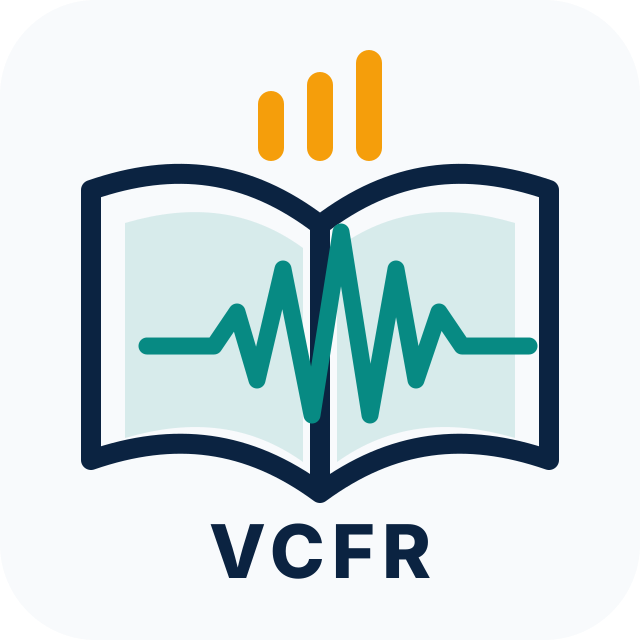

# VCFR — Voice Command For Readest



Asistente local de lectura por voz y captura de notas para lectores de libros electrónicos. VCFR controla lectores que anuncian sus controles mediante MPRIS (pausa, reanuda, frase anterior/siguiente y velocidad cuando el reproductor lo admite), reconoce órdenes con Vosk y usa un servidor compatible con la API de OpenAI en LM Studio para explicar el texto seleccionado. Las notas son Markdown, por lo que funcionan en Obsidian y otros editores.

**Estado:** demostración funcional en Linux; integración con Calibre empaquetada, todavía pendiente de validación dentro de una instalación real de Calibre. No se anuncia como extensión nativa universal.

## Qué hace

- Reconoce órdenes en español, inglés, francés y portugués con modelos locales; solo escucha después de activar el micrófono. La frase de activación se puede cambiar por cualquier palabra o frase en Preferencias.
- Guarda el párrafo identificado en una nota existente sin pausar ni cambiar el estado del lector; evita duplicados y guarda una copia de seguridad de la nota previa.
- Antes de escribir, comprueba que el texto coincide literalmente con un párrafo extraído del EPUB sin DRM. Si no puede identificarlo, no escribe nada.
- Puede pausar para explicar, resumir, dar un ejemplo, definir conceptos clave o proponer una pregunta; reanuda opcionalmente si la lectura estaba activa.
- Incluye botones, campo de texto, vista previa del párrafo, medidor de micrófono, diagnóstico, control de reproducción, velocidad, nota y lector MPRIS detectado.
- Mantiene el audio del libro en el lector: VCFR lee sus propias respuestas con voz local opcional.

## Propósito

VCFR busca que la lectura y la captura de ideas sean más accesibles: los comandos por voz y la narración del lector pueden ayudar a personas ciegas o con baja visión, y también a quien prefiere usar las manos para otra tarea. La interfaz aún debe mejorar su compatibilidad con lectores de pantalla; la accesibilidad completa es un objetivo de desarrollo, no una promesa de la versión actual.

Además de facilitar la lectura, VCFR puede servir como herramienta de **gestión personal del conocimiento**: conservar citas con su referencia, relacionar ideas y llevarlas a una bóveda Markdown/Obsidian. “Segundo cerebro” es una forma popular de llamar a esta práctica; aquí usamos el término más concreto para describir la función.

## Roadmap

- **Tarjetas de aprendizaje:** crear tarjetas de pregunta y respuesta desde fragmentos seleccionados, conservar la referencia al libro y exportar a formatos sencillos como CSV/Anki. La persona debe revisar cada tarjeta antes de guardarla.
- **Transcripción de videos y audio:** importar un archivo local, mostrar texto con marcas de tiempo, elegir fragmentos y guardarlos como notas con enlace al momento del video. Evaluar motores locales como [whisper.cpp](https://github.com/ggml-org/whisper.cpp) o [faster-whisper](https://github.com/SYSTRAN/faster-whisper); serían opciones técnicas a investigar, no dependencias actuales.
- **Accesibilidad de interfaz:** mejorar navegación por teclado, etiquetas accesibles, contraste y compatibilidad con lectores de pantalla.
- **Más lectores y exportadores:** añadir conectores solo cuando exista una interfaz fiable y documentada, manteniendo Markdown como formato de salida portable.

## Compatibilidad real

| Lector | Integración | Alcance actual |
| --- | --- | --- |
| Readest en Linux | MPRIS y aplicación compañera | Detecta controles y metadatos que exponga la versión instalada. Respaldo de teclado específico para la ventana de Readest, con confirmación de estado. No es un complemento interno de Readest. |
| Calibre | Complemento de acción de biblioteca | El ZIP abre el EPUB seleccionado en VCFR. No controla directamente la ventana independiente del visor de Calibre. Si el visor publica MPRIS, puede seleccionarse en VCFR. |
| Otros lectores de escritorio | MPRIS | Pueden funcionar si exponen estado, metadatos y acciones MPRIS compatibles; la lista se detecta al pulsar «Detectar lector». |
| ReadEra y lectores Android | Sin conector directo en esta versión | ReadEra es una aplicación Android; este proyecto aún no trae puente móvil. No requiere ni instala un componente Android. |

La documentación de Readest publica TTS y un complemento de Calibre para administrar libros, pero no una API general de extensiones de terceros para controlar su lector desde dentro. Calibre, en cambio, documenta los complementos de acciones de interfaz. VCFR usa esa vía para abrir su ventana compañera, no para modificar el visor. Véanse [Readest TTS](https://www.readest.com/docs/listen), [Readest releases](https://github.com/readest/readest/releases), [API de complementos de Calibre](https://manual.calibre-ebook.com/plugins.html) y [guía para crear complementos de Calibre](https://manual.calibre-ebook.com/creating_plugins.html).

## Requisitos

- Linux con escritorio gráfico, Python 3.10 o posterior, `python3-tk`, `xdotool`, `busctl`, `wpctl`, `pw-record` y `espeak-ng`.
- PipeWire/PulseAudio con una fuente de audio disponible.
- LM Studio u Ollama opcionales para preguntas; el control, guardado y comandos cerrados funcionan sin ningún modelo. Configura el servidor local ligado a `127.0.0.1`.
- Para órdenes habladas: Vosk y el modelo acústico del idioma seleccionado, descargado aparte; instrucciones abajo.
- El lector debe exponer MPRIS y metadatos con texto suficiente para reconocer el párrafo. La vista previa muestra cuándo VCFR no logra identificarlo.

## Instalación desde el código

```bash
git clone <URL-del-repositorio-VCFR>
cd VCFR
./setup.sh
```

`setup.sh` crea el entorno Python, instala dependencias y prepara la configuración de ejemplo. Para iniciar:

```bash
./vcfr/iniciar.sh
```

En `config.json`, define `note_path` a una nota Markdown y las rutas de los modelos de voz en `speech_models`. No compartas ese archivo: puede contener rutas personales y está excluido de Git. En Preferencias eliges idioma, frase de activación, y proveedor local de texto. La escucha permanece apagada al cerrar VCFR.

### Modelo de voz en español

Descarga los modelos ligeros desde [Vosk Models](https://alphacephei.com/vosk/models) y extráelos bajo `models/`. La tabla de abajo muestra los nombres configurados para español, inglés de EE. UU., francés y portugués brasileño. Debes descargar el modelo del idioma que vas a usar; VCFR no descarga modelos en segundo plano ni envía audio a la red. Cambia de idioma desde **Preferencias** y pulsa **Aplicar**.

### LM Studio

El modelo de IA es opcional. Las órdenes, el control del lector y guardar notas no lo necesitan. Para preguntas, abre LM Studio y habilita el servidor en `http://127.0.0.1:1234`, u Ollama en `http://127.0.0.1:11434`. Elige el proveedor en Preferencias, escribe el identificador del modelo y pulsa **Probar modelo local**. Ambos servidores pueden ejecutarse localmente sin una clave externa. Mantén la dirección en localhost. El texto del libro solo se manda al servidor elegido cuando preguntas algo.

Readest puede narrar el libro con su propia función de voz; VCFR puede controlarlo a través del lector compatible. La voz de respuesta opcional del sistema es independiente. No hace falta un modelo de IA para leer, reconocer órdenes o guardar capturas. ChatGPT y Claude son servicios alojados: sin API, VCFR no tiene una integración programática directa con ellos. Usarlos mediante su interfaz web requeriría una sesión iniciada y automatización de pantalla, que es más frágil y no se ofrece como conector en esta versión.

## Demo reproducible

Abre la bóveda Obsidian incluida en `demo-vault/` y la nota `03-Notas/Don Quijote - Notas de lectura.md`. El EPUB completo está en `01-Libros/Don Quijote/`. Con Readest abierto y la narración iniciada:

```bash
./vcfr/iniciar.sh \
  --book "demo-vault/01-Libros/Don Quijote/Don Quijote - Gutenberg 2000.epub" \
  --note "demo-vault/03-Notas/Don Quijote - Notas de lectura.md"
```

En VCFR, pulsa **Detectar lector**. Si el reproductor publica el párrafo en MPRIS, aparecerá en la vista previa. Di «[tu frase], guarda este párrafo» o pulsa el botón. Guardar mantiene la lectura en su estado actual. La nota incluida contiene una captura real de la primera parte del libro guardada con la misma rutina que usa el asistente.

El texto de Don Quijote es de dominio público; el archivo de demostración procede de [Project Gutenberg, eBook 2000](https://www.gutenberg.org/ebooks/2000) e incluye sus avisos dentro del EPUB. La licencia MIT cubre el código VCFR, **no** el libro ni los términos de Project Gutenberg. Project Gutenberg indica revisar la normativa del país desde el que se redistribuye: [política de derechos](https://www.gutenberg.org/policy/permission.html) y [licencia de sus archivos](https://www.gutenberg.org/policy/license.html).

## Complemento de Calibre

Instala `VCFR-Calibre.zip` desde **Preferencias → Complementos → Cargar complemento desde archivo**, reinicia Calibre, selecciona un libro EPUB y usa **Open with VCFR** o el atajo `Ctrl+Shift+Alt+V`. Define `VCFR_COMMAND` si `vcfr` no está en `PATH`. El conector copia el EPUB a una carpeta temporal para abrirlo; no cambia ni borra el original de la biblioteca.

El ZIP está construido con `python build_calibre_plugin.py`. Se recomienda probarlo en una copia de una biblioteca antes de adoptar el atajo. No se ha probado la carga en la interfaz de Calibre en esta sesión.

## Comandos

| Orden (tras tu frase de activación) | Acción |
| --- | --- |
| pausa / detente | Pausar y comprobar el estado |
| continúa / reanuda / sigue leyendo | Reanudar |
| guarda este párrafo / subraya este párrafo | Guardar la captura actual en Markdown sin detener la lectura |
| guarda el párrafo anterior | Guardar el párrafo previo identificado |
| guarda y pausa | Pausar y guardar la captura actual |
| explica este párrafo / resúmelo | Consultar LM Studio |
| dame un ejemplo / conceptos clave / hazme una pregunta | Consultar LM Studio |
| siguiente frase / frase anterior | Navegar si el lector lo admite |
| más lento / más rápido / velocidad normal | Ajustar velocidad MPRIS si se admite |
| abre la nota / diagnóstico / ayuda | Abrir destino, comprobar conexiones o mostrar ayuda |
| responde por escrito / responde con voz / detén tu voz | Preferencias de voz de VCFR |
| apaga el micrófono | Detener captura de audio |

## Privacidad y seguridad

El reconocimiento de voz, la extracción de EPUB y las notas se procesan localmente. El texto del libro solo se envía al servidor de LM Studio u Ollama que selecciones, en localhost, cuando pides una explicación, resumen o función similar. VCFR no evita DRM ni modifica el archivo del libro. Las acciones automatizadas son una lista cerrada; las respuestas del modelo no ejecutan comandos. Revisa la licencia local del modelo y las condiciones del lector.

El video de demostración (`demo/VCFR-Demo.mp4`) usa escenas gráficas originales y una narración neural local en español mexicano generada con Piper. No contiene grabaciones de usuarios ni llamadas a servicios de generación remotos. El texto de la narración, el generador de escenas y el script de reconstrucción se incluyen en `demo/`.

## Créditos y proyectos relacionados

- [MoneyPrinterTurbo](https://github.com/harry0703/MoneyPrinterTurbo) se usó en modo local para preparar las escenas de la demostración. Su código está bajo MIT; VCFR no incorpora su código fuente.
- [FFmpeg](https://github.com/FFmpeg/FFmpeg) se usó para unir las escenas y codificar el MP4 final; su distribución conserva los términos de la compilación local de FFmpeg.
- [Vosk API](https://github.com/alphacep/vosk-api) permite el reconocimiento de voz local. Vosk API usa Apache-2.0; cada modelo acústico conserva su propia licencia. Consulta [los modelos y licencias](https://alphacephei.com/vosk/models).
- [Requests](https://github.com/psf/requests) es la biblioteca HTTP utilizada por VCFR, bajo Apache-2.0.
- [Pillow](https://github.com/python-pillow/Pillow) se utiliza en el guion que genera las escenas ilustradas de la demo; Pillow usa la licencia HPND.
- [Piper](https://github.com/OHF-Voice/piper1-gpl) generó localmente la narración neural del video de demostración; el motor usa GPL-3.0. El modelo de voz `es_MX-claude-high` no se redistribuye por separado; su ficha indica que el conjunto de datos usa Apache-2.0. El audio generado se incluye como parte de la demo audiovisual, no como código de VCFR.
- [Readest](https://github.com/readest/readest) y su soporte TTS son el lector de referencia. VCFR se comunica con los controles públicos del escritorio/MPRIS; no contiene código de Readest.
- El conector de [Calibre](https://github.com/kovidgoyal/calibre) utiliza sus APIs documentadas; no copia código del proyecto.
- [LM Studio](https://github.com/lmstudio-ai) y [Ollama](https://github.com/ollama/ollama) son servidores locales opcionales compatibles con el formato de API utilizado; VCFR no incluye ni redistribuye sus binarios o modelos.
- [Project Gutenberg](https://github.com/gutenberg) aporta el texto de dominio público usado en la demo reproducible; el EPUB conserva sus avisos y condiciones propios.

Los proyectos de transcripción del roadmap, [whisper.cpp](https://github.com/ggml-org/whisper.cpp) y [faster-whisper](https://github.com/SYSTRAN/faster-whisper), se enlazan como posibles opciones para evaluar; no se integraron ni se copió su código en esta versión.

Los créditos no implican que los proyectos mencionados patrocinen o respalden VCFR. Revisa sus avisos de licencia al redistribuir componentes o recursos de terceros.

## Desarrollo

```bash
python3 -m compileall -q vcfr vcfr_calibre
python build_calibre_plugin.py
```

Las pruebas automatizadas están en `vcfr/test_app.py`. La interfaz de Calibre requiere el entorno Python embebido de Calibre para su verificación real.

## Licencia

El software VCFR se publica bajo [MIT](LICENSE). La obra de demostración conserva por separado los avisos y condiciones de Project Gutenberg.
